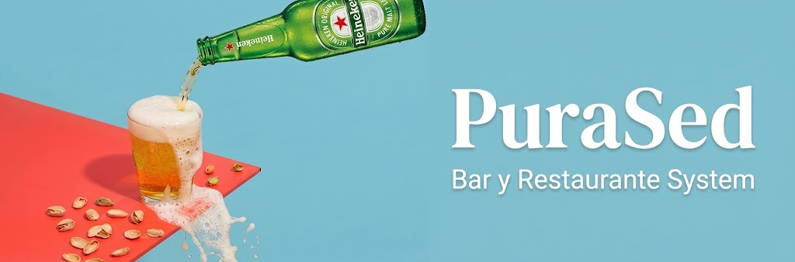
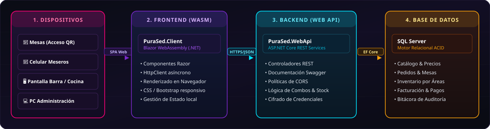

<p align="center">
  
</p>

<p align="center">
  <i>Pedidos por mesa, despacho automático a cocina y bar, cobro y reportes por jornada.</i>
</p>

<p align="center">
  
</p>

<p align="center">
  
  
  
  
</p>

<p align="center">
  <b>Escuela Politécnica Nacional (EPN)</b> · Facultad de Ingeniería Eléctrica y Electrónica (FIEE)<br/>
  <sub>ITID803 · Diseño de Aplicaciones y Servicios para Internet (DASI) · Semestre 2026</sub>
</p>

---

## Contenido

[Sobre el proyecto](#sobre-el-proyecto) · [Objetivo del sistema](#objetivo-del-sistema) · [Roles](#roles-del-sistema) · [Tecnologías](#tecnologías) · [Arquitectura](#arquitectura) · [Equipo](#equipo-scrum) · [Backlog](#backlog-del-producto) · [Avance por sprint](#avance-por-sprint) · [Estructura](#estructura-de-la-solución) · [Ejecución local](#ejecución-local) · [Flujo de trabajo en Git](#flujo-de-trabajo-en-git) · [Notas](#notas-adicionales)

---

##  Sobre el proyecto

**Pura Sed** es una plataforma web responsiva para la gestión integral de un bar nocturno. Digitaliza el ciclo completo de consumo: desde la consulta del menú y la comanda por mesa, hasta el despacho a cocina y bar, el cobro y el cierre de la jornada.

<table>
<tr>
<td width="50%" valign="top">

**Situación actual (gestión manual)**

- **Comandas en papel:** el mesero se desplaza a la barra y a la cocina, con demoras y confusiones.
- **Menú estático:** físico o en Canva, sin reflejar agotados ni promociones por horario.
- **Inventario sin control:** barra y cocina no sincronizan mermas ni stock mínimo.
- **Cobro y reservas manuales:** cuentas divididas, transferencias sin validar y reservas en una hoja de cálculo.

</td>
<td width="50%" valign="top">

**Qué resuelve el sistema**

- **Acceso por QR:** el cliente consulta el menú y el seguimiento desde su móvil, sin registrarse.
- **Enrutamiento automático:** los tragos van a la barra y los platos a la cocina.
- **Inventario por área:** descuento automático por pedido y bloqueo de productos agotados.
- **Pagos flexibles:** tarjeta (pasarela), transferencia con comprobante y efectivo, con factura secuencial.

</td>
</tr>
</table>

---

##  Objetivo del sistema

Diseñar e implementar una aplicación web que permita:

- Registrar productos (bebidas, comida, combos y espectáculos) con variantes y promociones.
- Gestionar pedidos, cuentas por mesa y reservas.
- Controlar el inventario de insumos por área (cocina y bar).
- Procesar pagos y emitir facturas.
- Medir la satisfacción del cliente y generar reportes de ventas por jornada.
- Administrar usuarios y roles con auditoría de acciones.

### Módulos del producto

El backlog contiene **32 historias de usuario (HU-01 a HU-32)** agrupadas en estos módulos:

| Módulo | Historias | Resumen |
| :-- | :-: | :-- |
| Acceso y seguridad | HU-01 a HU-04 | QR de mesa, login del personal, usuarios y roles, bitácora |
| Menú y promociones | HU-05 a HU-10 | Categorías, combos, variantes, descuentos por porcentaje, espectáculos, agotados |
| Inventario | HU-11, HU-12 | Ingreso de insumos y descuento automático por pedido |
| Pedidos | HU-13 a HU-16 | Registro por mesa, distribución a cocina y bar, estados, seguimiento |
| Reservas | HU-17 a HU-19 | Reserva en línea, gestión de la asistente, vista del administrador |
| Pagos y facturación | HU-20 a HU-24 | Habilitar cobro, tarjeta, transferencia, efectivo, factura |
| Satisfacción | HU-25, HU-26 | Calificación del mesero y del servicio general |
| Reportes | HU-27 a HU-32 | Ventas, desempeño, satisfacción, comparativos y exportación a Excel |

---

##  Roles del sistema

| Rol | Qué puede hacer |
| :-- | :-- |
| **Cliente** | Consultar el menú, hacer y seguir su pedido, reservar, pagar y calificar. No requiere cuenta. |
| **Mesero** | Registrar pedidos por mesa desde el celular o la tablet. |
| **Administrador de cocina** | Gestionar el inventario y los pedidos de cocina. |
| **Administrador de bar** | Gestionar el inventario y los pedidos del bar. |
| **Asistente** | Registrar, modificar y cancelar reservas. |
| **Administrador** | Menú, promociones, verificación de pagos, reportes, reservas y bitácora. |
| **Superadministrador** | Equipo técnico: usuarios, roles, configuración y mantenimiento, con acceso remoto. |

---

##  Tecnologías

| Área | Tecnología | Uso en el proyecto |
| :-- | :-- | :-- |
| Plataforma | `.NET SDK 10.0 / 9.0` | Ecosistema y compilación unificados |
| Frontend | `Blazor WebAssembly` | SPA en C# ejecutada en el navegador, con vistas por rol |
| Backend | `ASP.NET Core Web API` | API REST desacoplada, middleware y políticas CORS |
| Autenticación | `ASP.NET Core Identity` + `JWT` | Login del personal y validación de rol en cada petición |
| Tiempo real | `SignalR` | Pedidos y estados actualizados sin recargar |
| Documentación | `Swagger / OpenAPI` | Contrato de endpoints y pruebas |
| Base de datos | `SQL Server` | Pedidos, inventario, pagos y auditoría |
| ORM | `Entity Framework Core` | Mapeo objeto-relacional y migraciones |
| Pagos | Pasarela externa | Cobro con tarjeta sin almacenar datos sensibles |
| Pruebas de API | `Postman` | Verificación de respuestas y códigos HTTP |
| Control de versiones | `Git` y `GitHub` | Ramas `main` / `develop` y flujo con forks |
| Gestión ágil | `Jira Software` | Tablero Scrum, backlog y sprints |

---

##  Arquitectura

Arquitectura desacoplada: un frontend Blazor WebAssembly con vistas por rol consume una API REST en ASP.NET Core mediante HTTPS y JSON, con SignalR para el tiempo real. La API accede a SQL Server con Entity Framework Core y delega el cobro con tarjeta a una pasarela externa.

<p align="center">
  
</p>

### Diagrama de casos de uso

<p align="center">
  
</p>

---

##  Equipo Scrum

| Integrante | Rol Scrum | Responsabilidad |
| :-- | :-- | :-- |
| **Jose Naranjo** | Product Owner | Requerimientos y aceptación de entregables |
| **Jannys Garrido** | Scrum Master y desarrollo | Facilitación ágil, remoción de impedimentos y desarrollo |
| **Angel Chicaiza** | Equipo de desarrollo | Arquitectura de datos, lógica de backend y base de datos |
| **Angelo Conterón** | Equipo de desarrollo | Interfaces Blazor WASM, UX/UI y control de versiones |

---

##  Backlog del producto

El desarrollo se organiza en **sprints semanales** bajo Scrum. Las historias de usuario, sus criterios de aceptación y el flujo de tareas se administran en el tablero oficial:

<p align="center">
  <a href="https://jannysgarrido21.atlassian.net/jira/software/projects/SCRUM/boards/1?filter=&groupBy=none">
    
  </a>
</p>

### Avance por sprint

| Semana | Sprint / Entregable | Estado |
| :-: | :-- | :-: |
| 1 | Configuración de entorno y backlog |  |
| 2 | Diseño general del sistema |  |
| 3 | Registro y gestión de productos |  |
| 4 | Módulo de pedidos |  |

### Entregable del Sprint 1

- Repositorio con la solución `PuraSed.slnx` y ramas `main` y `develop`.
- **Backend:** Web API con Swagger y el controlador `CombosController` (`GET /api/combos`).
- **Frontend:** Blazor WebAssembly con pantalla inicial conectada a la API mediante `HttpClient`.
- **Integración:** CORS configurado en el backend para permitir solicitudes desde Blazor.
- Backlog en Jira, diagrama de casos de uso y diagrama de arquitectura.

---

##  Estructura de la solución

```text
pura-sed/
├── PuraSed.slnx                # Solución contenedora (formato XML de .NET)
├── README.md
├── .gitignore
│
├── assets/                     # Recursos del repositorio (banner, SVG, diagramas)
│   ├── banner.jpg
│   ├── architecture.svg
│   ├── casos-de-uso.png
│   ├── tech-stack.svg
│   └── icons/
│
├── PuraSed.WebApi/             # Backend: ASP.NET Core Web API
│   ├── Controllers/            # Controladores REST (CombosController)
│   ├── Properties/             # launchSettings.json
│   ├── appsettings.json        # Configuración del servidor
│   └── Program.cs              # Inyección de dependencias, middleware y CORS
│
└── PuraSed.Client/             # Frontend: Blazor WebAssembly
    ├── Layout/                 # MainLayout y NavMenu
    ├── Pages/                  # Vistas Razor
    ├── wwwroot/                # Archivos estáticos (CSS, imágenes)
    └── Program.cs              # Arranque de Blazor y HttpClient
```

> [!NOTE]
> A medida que avancen los sprints se sumarán carpetas como `Data/` (modelos y `DbContext`), `Migrations/` y `Shared/`.

---

##  Ejecución local

### Prerrequisitos

- [.NET SDK 9 o 10](https://dotnet.microsoft.com/download)
- [Visual Studio](https://visualstudio.microsoft.com/) o [Visual Studio Code](https://code.visualstudio.com/)
- SQL Server Express o SQL Server Management Studio
- [Git](https://git-scm.com/) y [Postman](https://www.postman.com/)

### Pasos

```bash
# 1. Clonar el repositorio (si trabajas con tu fork, usa tu usuario)
git clone https://github.com/Anghel01/pura-sed.git
cd pura-sed

# 2. Cambiar a la rama de desarrollo
git checkout develop

# 3. Restaurar dependencias
dotnet restore

# 4. Iniciar el backend (Web API)
cd PuraSed.WebApi
dotnet run
# Swagger: https://localhost:7001/swagger

# 5. En otra terminal, iniciar el frontend (Blazor WASM)
cd PuraSed.Client
dotnet run
# Aplicación: https://localhost:7100
```

> [!TIP]
> Los puertos dependen de `Properties/launchSettings.json`. Si cambian, actualiza también la URL base del `HttpClient` en `PuraSed.Client/Program.cs` y la política CORS en el backend.

---

##  Flujo de trabajo en Git

1. Hacer **fork** del repositorio canónico y clonarlo en la máquina local.
2. Trabajar sobre `develop`; `main` queda reservada para entregas estables.
3. Confirmar cambios con mensajes descriptivos siguiendo el prefijo `feat:`, `fix:` o `docs:`.
4. Al completar el entregable, abrir un **Pull Request** hacia el repositorio canónico.

---

## Notas adicionales

- Proyecto con fines académicos, desarrollado de forma incremental y alineado con prácticas ágiles.
- Para reportar errores o proponer mejoras, usa la sección de **Issues**.

---

## Licencia y uso académico

Proyecto desarrollado con fines académicos como parte de la formación en Ingeniería en Tecnologías de la Información de la **Escuela Politécnica Nacional**. Uso exclusivo del equipo de desarrollo y de los docentes tutores.
