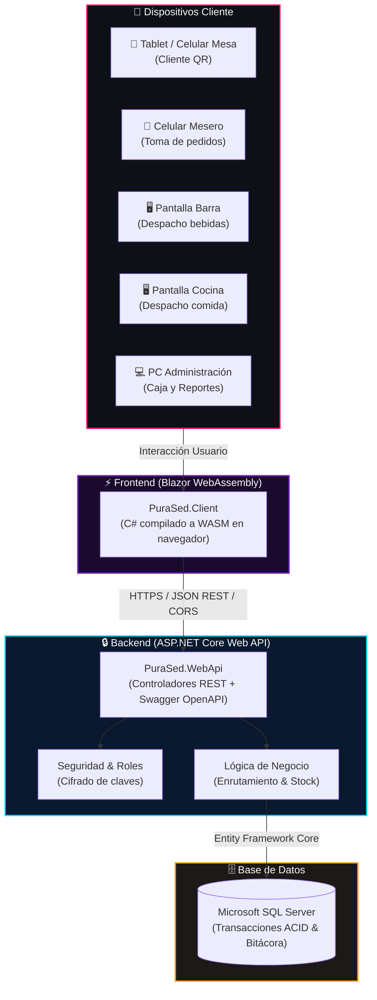

<p align="center">
  
</p>

<p align="center">
  <a href="https://git.io/typing-svg">
    
  </a>
</p>

<p align="center">
  
  
  
  
  
</p>

<p align="center">
  <b>Escuela Politécnica Nacional (EPN)</b> • Facultad de Ingeniería Eléctrica y Electrónica (FIEE)<br/>
  <i>ITID803: Diseño de Aplicaciones y Servicios para Internet (DASI) • Semestre 2026</i>
</p>

<p align="center">
  
</p>

## 📌 1. Sobre el Proyecto

**Pura Sed** es una solución web empresarial y responsiva diseñada para digitalizar de extremo a extremo las operaciones de un bar y restaurante nocturno. El proyecto reemplaza el flujo tradicional basado en papelitos y comandas físicas por una **arquitectura desacoplada en la nube**, reduciendo tiempos de espera, optimizando inventarios y enriqueciendo la experiencia del cliente.

<table>
<tr>
<td width="50%">

### ⚠️ Problemática Detectada
* **Comandas manuales en papel:** Desplazamientos innecesarios de meseros que enfrían comida y retrasan tragos.
* **Menú físico estático:** Imposibilidad de actualizar precios o marcar ítems agotados al instante.
* **Fuga de insumos:** Cocina y barra sin control sincronizado de stock mínimo.
* **Cuentas y cobro manual:** División de cuentas lenta y validación de transferencias desordenada.

</td>
<td width="50%">

### 💡 Solución Implementada
* **Atención por Mesa con QR:** Acceso instantáneo al menú interactivo sin fricción ni registro obligado.
* **Enrutamiento Inteligente:** La orden divide automáticamente tragos a la Barra y platos a la Cocina.
* **Inventario Descentralizado:** Descuento automático de existencias y bloqueo visual de agotados.
* **Pagos Transparentes:** Tarjeta, transferencia y efectivo con emisión de comprobante secuencial.

</td>
</tr>
</table>

---

## 🏛️ 2. Arquitectura del Sistema

El sistema implementa un modelo **Cliente-Servidor desacoplado** utilizando **Blazor WebAssembly** en el frontend y **ASP.NET Core Web API** en el backend.



---

## 💻 3. Tecnologías Utilizadas

<p align="center">
  
</p>

| Área | Tecnología | Propósito |
| :--- | :--- | :--- |
| **Plataforma** | `.NET SDK 10.0 / 9.0` | Ecosistema y motor de compilación unificado |
| **Frontend** | `Blazor WebAssembly` | Interfaz interactiva SPA ejecutada con C# nativo en el cliente |
| **Backend** | `ASP.NET Core Web API` | Microservicios RESTful, inyección de dependencias y CORS |
| **Documentación** | `Swagger / OpenAPI` | Especificación y catálogo interactivo de endpoints |
| **Base de Datos** | `Microsoft SQL Server` | Motor relacional con integridad referencial |
| **ORM** | `Entity Framework Core` | Mapeo objeto-relacional y migraciones de esquema |
| **Pruebas** | `Postman` | Verificación de contratos y respuestas HTTP de la API |
| **Control de Versiones**| `Git & GitHub` | Control de ramas (`main` / `develop`) y flujo colaborativo |
| **Gestión Ágil** | `Jira Software` | Tablero Scrum, épicas, historias y seguimiento de sprints |

---

## 👥 4. Equipo de Trabajo (Scrum Team)

<table align="center" width="100%">
  <tr>
    <td align="center" width="25%">
      <br/>
      <b>Jose Naranjo</b><br/>
      <code>Product Owner</code><br/>
      <sub>Definición de requerimientos y aceptación de entregables</sub>
    </td>
    <td align="center" width="25%">
      <br/>
      <b>Jannys Garrido</b><br/>
      <code>Scrum Master / Dev</code><br/>
      <sub>Facilitación ágil, remoción de impedimentos y desarrollo</sub>
    </td>
    <td align="center" width="25%">
      <br/>
      <b>Angel Chicaiza</b><br/>
      <code>Development Member</code><br/>
      <sub>Arquitectura de datos, lógica de backend y base de datos</sub>
    </td>
    <td align="center" width="25%">
      <br/>
      <b>Angelo Conteron</b><br/>
      <code>Development Member</code><br/>
      <sub>Interfaces Blazor WASM, UX/UI y control de versiones Git</sub>
    </td>
  </tr>
</table>

---

## 📋 5. Backlog del Producto y Gestión Ágil

El desarrollo del proyecto se gestiona bajo ciclos de entrega continuos (Sprints semanales). El detalle completo de las **Historias de Usuario (HU-01 a HU-32)**, tareas técnicas y criterios de aceptación se gestionan en tiempo real en nuestro tablero:

<p align="center">
  <a href="https://jannysgarrido21.atlassian.net/jira/software/projects/SCRUM/boards/1?filter=&groupBy=none">
    
  </a>
</p>

---

## 📂 6. Estructura de la Solución .NET

```text
pura-sed/
├── PuraSed.slnx              # 📦 Solución contenedora (.NET 9/10 XML format)
├── README.md                 # 📄 Documentación visual del proyecto
├── .gitignore                # 🛡️ Reglas de exclusión para Git (.NET)
│
├── PuraSed.WebApi/           # ⚙️ [BACKEND] ASP.NET Core Web API
│   ├── Controllers/          # Controladores REST (ej. CombosController)
│   ├── Properties/           # Perfiles de ejecución (launchSettings.json)
│   ├── appsettings.json      # Configuración y variables del servidor
│   ├── Program.cs            # Punto de entrada, Middleware, Swagger y CORS
│   └── PuraSed.WebApi.csproj # Cédula del proyecto Backend y paquetes NuGet
│
└── PuraSed.Client/           # 🎨 [FRONTEND] Blazor WebAssembly
    ├── Layout/               # Estructuras visuales (MainLayout, NavMenu)
    ├── Pages/                # Vistas Razor (Home, Counter, Menu, Pedidos)
    ├── wwwroot/              # Archivos estáticos (Bootstrap, CSS, íconos)
    ├── Program.cs            # Inicializador de Blazor WASM y HttpClient
    └── PuraSed.Client.csproj # Cédula del proyecto Frontend
```

---

## 🚀 7. Guía de Ejecución Local

### Prerrequisitos
* [.NET SDK 8, 9 o 10](https://dotnet.microsoft.com/download)
* [Visual Studio 2022+](https://visualstudio.microsoft.com/) o [Visual Studio Code](https://code.visualstudio.com/)
* [Git](https://git-scm.com/)

### Paso a paso

```bash
# 1. Clonar el repositorio
git clone https://github.com/Anghel01/pura-sed.git
cd pura-sed

# 2. Cambiar a la rama de desarrollo
git checkout develop

# 3. Restaurar dependencias de la solución
dotnet restore

# 4. Iniciar el Backend (Web API)
cd PuraSed.WebApi
dotnet run
# -> Swagger disponible en: https://localhost:7001/swagger

# 5. En otra terminal, iniciar el Frontend (Blazor WASM)
cd PuraSed.Client
dotnet run
# -> Aplicación cargando en: https://localhost:7100
```

---

## 📅 8. Cronograma y Avance por Sprints

| Sprint / Semana | Entregable / Alcance | Estado |
| :---: | :--- | :---: |
| **Sprint 1 (Sem. 1)** | Configuración de entorno, estructura .NET (`PuraSed.slnx`), Web API + Blazor y CORS | 🟢 **Terminado** |
| **Sprint 2 (Sem. 2)** | Modelado relacional en SQL Server, DbContext y migraciones EF Core | 🟡 En progreso |
| **Sprint 3 (Sem. 3)** | Catálogo interactivo de productos, combos y variantes | ⚪ Planificado |
| **Sprint 4 (Sem. 4)** | Módulo de pedidos por mesa y despacho automático a cocina/bar | ⚪ Planificado |
| **Sprint 5-16** | Reservas QR, pasarela de pago, facturación, encuestas y analítica | ⚪ Planificado |

---

## 📄 9. Licencia y Uso Académico

Este proyecto ha sido desarrollado exclusivamente con fines académicos como parte de la formación profesional en Ingeniería de Tecnologías de la Información en la **Escuela Politécnica Nacional**. Todos los derechos reservados al equipo de desarrollo y docentes tutores.

<p align="center">
  
</p>