<p align="center">
  
</p>

<p align="center">
  <b>Sistema Transaccional en Tiempo Real para Gestión Integral de Bares Nocturnos y Restaurantes</b><br/>
  <i>Pedidos digitales por mesa mediante QR, enrutamiento desacoplado a barra y cocina, control de existencias y arqueo de caja por jornada.</i>
</p>

<p align="center">
  
</p>

<p align="center">
  <b>Escuela Politécnica Nacional (EPN)</b> · Facultad de Ingeniería Eléctrica y Electrónica (FIEE)<br/>
  <sub>ITID803 · Diseño de Aplicaciones y Servicios para Internet (DASI) · Periodo Académico 2026</sub>
</p>

---

## Contenido

- [Resumen Ejecutivo y Problemática](#resumen-ejecutivo-y-problemática)
- [Objetivos del Sistema y Alcance Funcional](#objetivos-del-sistema-y-alcance-funcional)
- [Roles de Usuario y Matriz de Acceso](#roles-de-usuario-y-matriz-de-acceso)
- [Ecosistema Tecnológico](#ecosistema-tecnológico)
- [Arquitectura de Software](#arquitectura-de-software)
- [Equipo Scrum y Roles](#equipo-scrum-y-roles)
- [Planificación y Avance por Sprints](#planificación-y-avance-por-sprints)
- [Estructura de la Solución](#estructura-de-la-solución)
- [Guía de Ejecución Local](#guía-de-ejecución-local)
- [Flujo de Trabajo en Git](#flujo-de-trabajo-en-git)
- [Licencia y Uso Académico](#licencia-y-uso-académico)

---

## Resumen Ejecutivo y Problemática

**PuraSed** es una plataforma web reactiva y transaccional concebida para modernizar el ciclo operativo de bares nocturnos y restaurantes. Resuelve las fricciones habituales de la toma de órdenes física, la sincronización entre salón y áreas de despacho (cocina y barra), y el control financiero al cierre de turno.

| Dimensión Operativa | Gestión Tradicional (Manual) | Solución Digital con PuraSed |
| :--- | :--- | :--- |
| **Toma de Comandas** | Notas en papel; el mesero se desplaza constantemente, generando cuellos de botella y errores en comandas. | **Acceso QR sin autenticación**: el cliente explora el menú dinámico y pide desde su móvil; el mesero asiste mediante tablet. |
| **Catálogo y Disponibilidad** | Cartas físicas o pizarras estáticas que no alertan sobre mermas ni platos agotados durante la jornada. | **Control de stock en tiempo real**: bloqueo automático de insumos no disponibles y actualización instantánea de precios y combos. |
| **Distribución a Despacho** | Comandas físicas divididas a mano entre coctelería y cocina con extravíos frecuentes. | **Enrutamiento inteligente por SignalR**: los tragos entran a la pantalla de la barra y la comida al monitor de cocina de forma simultánea. |
| **Cobro y Facturación** | Cuentas divididas calculadas manualmente, comprobantes de transferencia sin verificar y cuadre demorado. | **Flujo multicanal validado**: pasarela para tarjeta, carga digital de transferencias y arqueo consolidado con facturación secuencial. |

---

## Objetivos del Sistema y Alcance Funcional

Implementar un sistema web desacoplado y de alta disponibilidad que permita:

- Centralizar la gestión del menú (bebidas preparadas, licores, platos, combos y entradas a eventos) con modificadores y descuentos por franja horaria.
- Enrutar pedidos en tiempo real con estados de preparación y despacho coordinados mediante SignalR.
- Controlar el stock de insumos y mermas por área (cocina vs. barra) mediante descuentos automáticos por receta al emitir la comanda.
- Gestionar reservas de mesas y verificar comprobantes de pago digitales con auditoría de transacciones.
- Registrar encuestas breves de satisfacción del cliente y generar reportes financieros consolidados por jornada de trabajo.

### Módulos del Backlog de Producto

El producto cuenta con **32 historias de usuario (HU-01 a HU-32)** estructuradas en ocho áreas funcionales:

| Módulo | Alcance de Historias | Descripción Funcional |
| :--- | :---: | :--- |
| **Acceso y Seguridad** | HU-01 a HU-04 | Sesiones seguras con ASP.NET Core Identity y JWT, auditoría en bitácora de eventos y QR estático/dinámico por mesa. |
| **Menú y Promociones** | HU-05 a HU-10 | Configuración de cartas, combos por horario, variantes de coctelería, alertas de agotado y catálogo de espectáculos. |
| **Inventario por Área** | HU-11 a HU-12 | Registro de materias primas e insumos, vinculación por receta y descargo automático contra comanda confirmada. |
| **Comandas y Despacho** | HU-13 a HU-16 | Registro móvil, segregación automática (barra vs. cocina), estados (pendiente, en preparación, listo) y telemetría. |
| **Gestión de Reservas** | HU-17 a HU-19 | Reserva web por turnos, panel de control para la asistente y visualización global para el administrador. |
| **Cobro y Facturación** | HU-20 a HU-24 | Cierre de mesa, división de cuentas, cobro con tarjeta, validación de transferencias y generación de facturas con desglose de impuestos. |
| **Satisfacción del Cliente** | HU-25 a HU-26 | Módulo de valoración por estrellas y comentarios rápidos sobre servicio del mesero y experiencia de local. |
| **Analítica y Reportes** | HU-27 a HU-32 | Tablero de ingresos por jornada, productos más vendidos, rendimiento por mesero, reporte de mermas y exportación a Excel. |

---

## Roles de Usuario y Matriz de Acceso

| Rol | Privilegios y Responsabilidades |
| :--- | :--- |
| **Cliente** | Visualización interactiva del menú vía QR, emisión y seguimiento en vivo del pedido, solicitud de cuenta, pago digital y calificación. No requiere registro previo. |
| **Mesero** | Toma de pedidos en mesa, adición de modificadores, apertura/cierre operativo de mesa y asistencia al cliente desde terminal móvil. |
| **Administrador de Cocina** | Visualización en pantalla de comandas de alimentos, control de tiempos de preparación, notificación de despacho y ajuste de stock de insumos de cocina. |
| **Administrador de Barra** | Monitor de tragos y coctelería en tiempo real, validación de insumos de bar, registro de mermas y notificación de bebidas listas. |
| **Asistente de Reservas** | Recepción de solicitudes de reserva, asignación de mesas según capacidad y confirmación de depósitos previos. |
| **Administrador General** | Mantenimiento de catálogo, gestión de precios y combos, aprobación de transferencias bancarias, arqueo de caja y consulta de analítica de negocio. |
| **Superadministrador** | Gestión de infraestructura técnica, altas y bajas de cuentas del personal, asignación de roles RBAC, consulta de bitácoras y despliegues. |

---

## Ecosistema Tecnológico

El proyecto está construido enteramente sobre la versión más reciente de la plataforma .NET, garantizando máxima coherencia de tipos y rendimiento nativo.

| Capa / Dominio | Tecnología | Justificación Técnica |
| :--- | :--- | :--- |
| **Runtime & SDK** | `.NET 10.0 SDK` (`net10.0`) | Compilación unificada de backend y frontend con soporte para C# 13, optimizaciones JIT y mejoras en WebAssembly. |
| **Frontend SPA** | `Blazor WebAssembly` | Single Page Application ejecutada del lado del cliente vía WebAssembly, permitiendo compartir DTOs y validaciones con la API. |
| **Backend REST** | `ASP.NET Core Web API` | Controladores desacoplados, middleware de compresión, autorización por políticas RBAC y configuración estricta de CORS. |
| **Tiempo Real** | `SignalR Core` | Canales bidireccionales basados en WebSockets con fallback para la propagación instantánea de comandas a barra y cocina. |
| **Persistencia** | `Microsoft SQL Server` | Motor relacional transaccional (ACID) para el resguardo de pedidos, transacciones de pago, auditoría e inventario. |
| **ORM** | `Entity Framework Core` | Mapeo objeto-relacional con migraciones Code-First, consultas LINQ optimizadas y concurrencia optimista. |
| **Contrato de API** | `OpenAPI v1` (`Microsoft.AspNetCore.OpenApi`) | Especificación de endpoints generada en tiempo de compilación y expuesta en `/openapi/v1.json`. |
| **Control de Versiones** | `Git` y `GitHub` | Flujo distribuido con bifurcaciones (forks), ramas protegidas `main` y de integración continua `develop`. |
| **Gestión de Proyecto** | `Jira Software (Cloud)` | Metodología ágil Scrum con estimación en Story Points, tablero interactivo y sprints semanales de entrega. |

---

## Arquitectura de Software

La solución implementa una **arquitectura desacoplada basada en servicios REST y eventos en tiempo real**. El cliente Blazor WebAssembly consume los recursos expuestos por la Web API mediante HTTPS y payloads serializados en JSON. Las notificaciones críticas de despacho y estado de mesa se transmiten a través de hubs de SignalR, mientras que el almacenamiento se delega a SQL Server con Entity Framework Core.

<p align="center">
  
</p>

### Diagrama de Casos de Uso

<p align="center">
  
</p>

---

## Equipo Scrum y Roles

El proyecto se gestiona bajo el marco de trabajo **Scrum**, con roles definidos para asegurar la alineación entre los requerimientos académicos, la experiencia de usuario y la arquitectura de software.

<table>
  <tr>
    <td width="50%" align="center" valign="top">
      
    </td>
    <td width="50%" align="center" valign="top">
      <a href="https://github.com/JannysG1">
        
      </a>
    </td>
  </tr>
  <tr>
    <td width="50%" align="center" valign="top">
      <a href="https://github.com/angelch1595-glitch">
        
      </a>
    </td>
    <td width="50%" align="center" valign="top">
      <a href="https://github.com/Anghel01">
        
      </a>
    </td>
  </tr>
</table>

---

## Planificación y Avance por Sprints

El ciclo de desarrollo comprende **sprints semanales** sincronizados con el tablero oficial de Atlassian Jira:

<p align="center">
  <a href="https://jannysgarrido21.atlassian.net/jira/software/projects/SCRUM/boards/1?filter=&groupBy=none">
    <b>Abrir Tablero de Gestión Ágil en Jira Software</b>
  </a>
</p>

| Sprint / Semana | Entregable Principal | Estado Actual |
| :---: | :--- | :---: |
| **Sprint 1** | Scaffolding de arquitectura, solución `.slnx`, Web API inicial, cliente Blazor WASM y backlog priorizado. | **En curso** |
| **Sprint 2** | Modelado de datos en EF Core, migraciones de base de datos y diseño UX/UI del catálogo de productos. | **Planificado** |
| **Sprint 3** | Registro interactivo de productos, combos, variantes por horario y lógica de inventario por recetas. | **Planificado** |
| **Sprint 4** | Módulo de pedidos en mesa, distribución en tiempo real con SignalR hacia barra y cocina. | **Planificado** |

### Alcance Entregable del Sprint 1

- Solución `.slnx` estructurada en .NET 10 con compilación validada.
- **Backend (`PuraSed.WebApi`)**: Endpoint de verificación de servicios y especificación OpenAPI activa en `/openapi/v1.json`.
- **Frontend (`PuraSed.Client`)**: Shell Blazor WebAssembly configurado con inyección de dependencias para `HttpClient`.
- **Interconexión**: Políticas de CORS habilitadas en el servidor para aceptar orígenes de desarrollo local (`localhost:7020` / `localhost:5068`).
- **Gobierno del Proyecto**: Repositorio canónico con flujo de ramas (`main` y `develop`), artefactos vectoriales adaptativos y tablero Jira configurado.

---

## Estructura de la Solución

El repositorio implementa el nuevo estándar de solución XML de .NET (`.slnx`), facilitando la integración limpia entre herramientas de compilación y entornos IDE:

```text
pura-sed/
├── PuraSed.slnx                       # Definición de la solución .NET (formato moderno SLNX)
├── README.md                          # Documentación arquitectónica y guía técnica
├── .gitignore                         # Exclusiones estándar de compilación .NET
│
├── assets/                            # Recursos vectoriales y artefactos visuales
│   ├── banner.svg                     # Hero banner nativo adaptativo con animación SVG
│   ├── banner.jpg                     # Fotografía base de alta resolución
│   ├── tags.svg                       # Lienzo espacial de 1200px con flujo de tecnologías
│   ├── architecture.svg               # Diagrama de arquitectura de micro-servicios
│   ├── casos-de-uso.png               # Modelo UML de casos de uso y roles
│   ├── icons/                         # Iconografía técnica vectorial del sistema
│   └── team/                          # Tarjetas vectoriales simétricas del Scrum Team
│
├── PuraSed.WebApi/                    # Núcleo de servicios REST (ASP.NET Core Web API)
│   ├── Controllers/                   # Controladores RESTful
│   ├── Properties/                    # launchSettings.json (Perfiles HTTP 5107 / HTTPS 7129)
│   ├── appsettings.json               # Configuración de entornos y cadenas de conexión
│   └── Program.cs                     # Inyección de dependencias, OpenAPI y pipeline HTTP
│
└── PuraSed.Client/                    # Interfaz de usuario SPA (Blazor WebAssembly)
    ├── Layout/                        # Shell general (MainLayout, NavMenu)
    ├── Pages/                         # Vistas Razor por perfil de usuario
    ├── Properties/                    # launchSettings.json (Perfiles HTTP 5068 / HTTPS 7020)
    ├── wwwroot/                       # Recursos estáticos (CSS, fuentes, favicon)
    └── Program.cs                     # Punto de entrada WebAssembly y configuración de HttpClient
```

---

## Guía de Ejecución Local

### Prerrequisitos de Instalación

1. **.NET 10.0 SDK** (requerido estrictamente para compilar `net10.0`). Verificar en terminal con `dotnet --version`.
2. **Entorno de desarrollo**: Visual Studio 2022 (v17.13 o superior con la carga de trabajo *ASP.NET y desarrollo web*) o Visual Studio Code con la extensión *C# Dev Kit*.
3. **Gestor de base de datos**: SQL Server 2022 / Express Edition y SQL Server Management Studio (SSMS) o Azure Data Studio.
4. **Git**: Cliente Git 2.40+.

### Pasos de Puesta en Marcha

#### 1. Obtención del código y sincronización de rama

```bash
# Clonar el repositorio canónico (o tu fork personal)
git clone https://github.com/Anghel01/pura-sed.git
cd pura-sed

# Conmutar a la rama de integración activa
git checkout develop

# Restaurar paquetes NuGet en toda la solución
dotnet restore
```

#### 2. Ejecución del Servidor Web API

En una primera terminal, levanta el backend usando el perfil HTTPS:

```bash
dotnet run --project PuraSed.WebApi --launch-profile https
```

- **URL de servicio HTTPS**: `https://localhost:7129`
- **URL de servicio HTTP**: `http://localhost:5107`
- **Especificación OpenAPI**: `https://localhost:7129/openapi/v1.json`

#### 3. Ejecución del Cliente Blazor WebAssembly

En una segunda terminal independiente, inicia la aplicación cliente:

```bash
dotnet run --project PuraSed.Client --launch-profile https
```

- **Aplicación Web HTTPS**: `https://localhost:7020`
- **Aplicación Web HTTP**: `http://localhost:5068`

> [!NOTE]
> En la primera ejecución bajo HTTPS en Windows, es recomendable registrar el certificado de desarrollo mediante el comando `dotnet dev-certs https --trust` para evitar advertencias de seguridad en el navegador.

---

## Flujo de Trabajo en Git

1. **Bifurcación (Fork)**: Cada integrante del equipo trabaja desde su fork personal en GitHub (`JannysG1`, `angelch1595-glitch`, `Anghel01`).
2. **Ramas de Trabajo**:
   - `main`: Reservada exclusivamente para entregas cerradas de fin de sprint validadas por el Product Owner.
   - `develop`: Rama integradora protegida; todo trabajo activo se sincroniza contra esta rama.
   - `feat/nombre-funcionalidad`: Ramas de corta duración creadas para historias de usuario específicas.
3. **Convención de Confirmaciones**: Uso riguroso de Conventional Commits (`feat:`, `fix:`, `docs:`, `refactor:`, `chore:`).
4. **Pull Requests**: Se requiere revisión de código antes de autorizar el merge hacia la rama `develop`.

---

## Licencia y Uso Académico

Proyecto desarrollado con fines académicos en el marco de la asignatura **ITID803 · Diseño de Aplicaciones y Servicios para Internet (DASI)** de la Facultad de Ingeniería Eléctrica y Electrónica (FIEE) en la **Escuela Politécnica Nacional**. 

Derechos reservados © 2026 Escuela Politécnica Nacional. Uso restringido al equipo de desarrollo y al cuerpo docente tutor.
