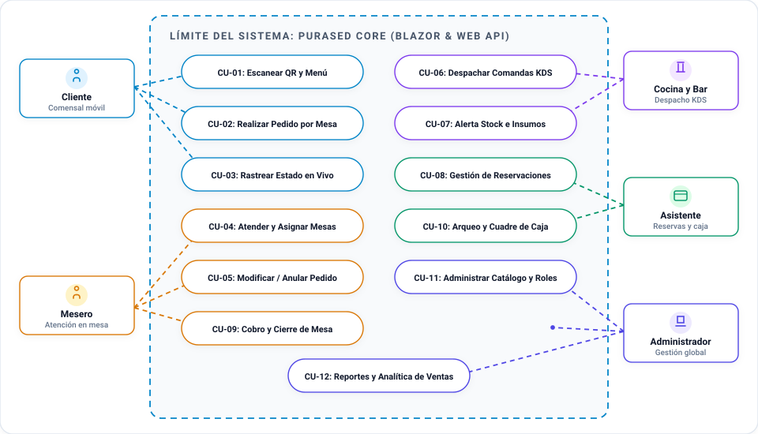

<p align="center">
  
</p>

<p align="center">
  <b>Sistema Transaccional en Tiempo Real para Gestión Integral de Bares Nocturnos y Restaurantes</b><br/>
  <i>Pedidos digitales por mesa con QR, enrutamiento desacoplado a cocina y barra, control de inventario y facturación por jornada.</i>
</p>

<p align="center">
  
</p>

<p align="center">
  <b>Escuela Politécnica Nacional (EPN)</b> · Facultad de Ingeniería Eléctrica y Electrónica (FIEE)<br/>
  <sub>ITID803 · Diseño de Aplicaciones y Servicios para Internet (DASI) · Periodo Académico 2026</sub>
</p>

---

## Contenido

- [Sobre el Proyecto](#sobre-el-proyecto)
- [Objetivo del Sistema](#objetivo-del-sistema)
- [Arquitectura de Software](#arquitectura-de-software)
- [Diagrama de Casos de Uso](#diagrama-de-casos-de-uso)
- [Equipo Scrum y Roles](#equipo-scrum-y-roles)
- [Backlog del Producto y Sprints](#backlog-del-producto-y-sprints)
- [Estructura de la Solución](#estructura-de-la-solución)
- [Guía de Ejecución Local](#guía-de-ejecución-local)
- [Flujo de Trabajo en Git](#flujo-de-trabajo-en-git)
- [Licencia y Uso Académico](#licencia-y-uso-académico)

---

## Sobre el Proyecto

**PuraSed** es una plataforma web reactiva que moderniza el flujo operativo completo de un bar nocturno y restaurante, eliminando las comandas físicas en papel, las demoras en el enrutamiento a cocina y barra, y los errores de cuadre al cierre de jornada.

| Dimensión Operativa | Gestión Tradicional (Manual) | Solución Digital con PuraSed |
| :--- | :--- | :--- |
| **Atención en Mesa** | Comandas físicas en papel; desplazamientos constantes y confusiones de mesa. | **Acceso QR sin fricción**: el cliente pide y consulta el estado de su orden desde su dispositivo móvil sin registro previo. |
| **Catálogo y Menú** | Cartas físicas o imágenes estáticas en Canva que no avisan de productos agotados. | **Disponibilidad en tiempo real**: bloqueo automático de insumos agotados y promociones por franja horaria. |
| **Despacho a Cocina y Bar** | Comandas divididas manualmente entre coctelería y cocina con extravíos frecuentes. | **Enrutamiento automático con SignalR**: derivación simultánea de bebidas a la barra y comidas a la cocina. |
| **Cobro y Facturación** | Cuentas divididas a mano, validación tardía de transferencias y cuadres manuales. | **Pasarela integrada y arqueo**: cobro con tarjeta, verificación de transferencias y emisión secuencial de facturas. |

---

## Objetivo del Sistema

Diseñar e implementar una solución web desacoplada y de alta disponibilidad que permita:

- **Catálogo Dinámico**: Administrar bebidas, alimentos, combos por horario y espectáculos con variantes e insumos configurables.
- **Enrutamiento Reactivo**: Transmitir pedidos en tiempo real con actualización continua de estados (*Pendiente* $\rightarrow$ *En preparación* $\rightarrow$ *Listo* $\rightarrow$ *Entregado*).
- **Inventario por Área**: Descontar existencias automáticamente por receta con alertas de stock mínimo para cocina y bar.
- **Gestión de Reservas y Pagos**: Agendar mesas en línea, verificar comprobantes de pago digitales y consolidar la caja por jornada.
- **Analítica de Negocio**: Evaluar la satisfacción del cliente y generar reportes financieros al cierre de turno.

---

## Arquitectura de Software

La plataforma adopta una **arquitectura en capas desacoplada**, estructurada en dispositivos de usuario, cliente SPA en Blazor WebAssembly, núcleo de servicios REST en ASP.NET Core y persistencia en SQL Server, coordinados mediante hubs de SignalR para eventos en vivo:

<p align="center">
  
</p>

---

## Diagrama de Casos de Uso

Representación formal de las interacciones entre los actores del negocio (*Cliente*, *Mesero*, *Cocina/Bar*, *Asistente* y *Administrador*) y los casos de uso nucleares del sistema:

<p align="center">
  
</p>

---

## Equipo Scrum y Roles

El desarrollo se gestiona bajo el marco de trabajo **Scrum**, con responsabilidades distribuidas entre el docente asesor y los desarrolladores del equipo:

<table>
  <tr>
    <td width="50%" align="center" valign="top">
      
    </td>
    <td width="50%" align="center" valign="top">
      <a href="https://github.com/JannysG1">
        
      </a>
    </td>
  </tr>
  <tr>
    <td width="50%" align="center" valign="top">
      <a href="https://github.com/angelch1595-glitch">
        
      </a>
    </td>
    <td width="50%" align="center" valign="top">
      <a href="https://github.com/Anghel01">
        
      </a>
    </td>
  </tr>
</table>

---

## Backlog del Producto y Sprints

El ciclo de desarrollo está organizado en **sprints semanales** sincronizados en tiempo real con el tablero oficial de Atlassian Jira Software, donde se gestionan las **32 Historias de Usuario (HU-01 a HU-32)** y sus criterios de aceptación:

<p align="center">
  <a href="https://jannysgarrido21.atlassian.net/jira/software/projects/SCRUM/boards/1?filter=&groupBy=none">
    
  </a>
</p>

| Semana / Sprint | Entregable Principal de la Práctica | Estado |
| :---: | :--- | :---: |
| **Sprint 1** | Configuración de entorno, solución `.slnx`, Web API inicial, Blazor WASM y Backlog priorizado. | **En curso** |
| **Sprint 2** | Modelado de datos en EF Core, migraciones de base de datos y diseño UI del catálogo. | **Planificado** |
| **Sprint 3** | Registro y gestión de productos, variantes por horario e inventario por recetas. | **Planificado** |
| **Sprint 4** | Módulo de pedidos por mesa y despacho en tiempo real con SignalR hacia cocina y bar. | **Planificado** |

> [!NOTE]
> Las especificaciones detalladas, criterios de aceptación (*Given-When-Then*) y estimaciones en Story Points se administran directamente en el **[Tablero Oficial de Jira](https://jannysgarrido21.atlassian.net/jira/software/projects/SCRUM/boards/1?filter=&groupBy=none)**.

---

## Estructura de la Solución

El repositorio utiliza el formato de solución de .NET (`.slnx`), garantizando un desacoplamiento limpio entre la capa de presentación y los servicios backend:

```text
pura-sed/
├── PuraSed.slnx                       # Archivo contenedor de la solución .NET
├── README.md                          # Documentación del proyecto
├── .gitignore                         # Exclusiones estándar de compilación
│
├── assets/                            # Recursos vectoriales y diagramas
│   ├── banner.svg                     # Banner animado (burbujas y espuma)
│   ├── tags.svg                       # Lienzo tecnológico con logos oficiales
│   ├── architecture.svg               # Arquitectura en capas y ciclo SignalR
│   ├── casos-de-uso.svg               # Diagrama UML de casos de uso
│   ├── jira-board.svg                 # Banner interactivo para acceso a Jira
│   └── team/                          # Tarjetas vectoriales del Scrum Team
│
├── PuraSed.WebApi/                    # Backend: ASP.NET Core Web API (.NET 10)
│   ├── Controllers/                   # Controladores RESTful
│   ├── Properties/                    # launchSettings.json (Perfiles HTTP 5107 / HTTPS 7129)
│   ├── appsettings.json               # Configuración de servicios y conexión
│   └── Program.cs                     # Inyección de dependencias, OpenAPI y pipeline HTTP
│
└── PuraSed.Client/                    # Frontend: Blazor WebAssembly (.NET 10)
    ├── Layout/                        # Componentes de diseño (MainLayout, NavMenu)
    ├── Pages/                         # Vistas Razor por rol de usuario
    ├── Properties/                    # launchSettings.json (Perfiles HTTP 5068 / HTTPS 7020)
    ├── wwwroot/                       # Archivos estáticos (CSS, scripts)
    └── Program.cs                     # Arranque WebAssembly y cliente HTTP
```

---

## Guía de Ejecución Local

### Prerrequisitos de Instalación

1. **.NET 10.0 SDK** (requerido estrictamente para compilar `net10.0`). Verificar con `dotnet --version`.
2. **Visual Studio 2022** (v17.13+ con carga de trabajo *ASP.NET y desarrollo web*) o **Visual Studio Code** con *C# Dev Kit*.
3. **Microsoft SQL Server** (Express, Developer o LocalDB) y SQL Server Management Studio (SSMS).
4. **Git CLI** (v2.40+).

### Pasos de Puesta en Marcha

```bash
# 1. Clonar el repositorio y conmutar a la rama de integración
git clone https://github.com/Anghel01/pura-sed.git
cd pura-sed
git checkout develop

# 2. Restaurar dependencias del proyecto
dotnet restore

# 3. Iniciar el Backend (Web API) en una terminal
dotnet run --project PuraSed.WebApi --launch-profile https
# HTTPS: https://localhost:7129 | HTTP: http://localhost:5107
# OpenAPI Spec: https://localhost:7129/openapi/v1.json

# 4. Iniciar el Frontend (Blazor WASM) en una segunda terminal
dotnet run --project PuraSed.Client --launch-profile https
# Aplicación Web: https://localhost:7020 | HTTP: http://localhost:5068
```

> [!TIP]
> En la primera ejecución con HTTPS, ejecuta `dotnet dev-certs https --trust` para habilitar el certificado local de desarrollo en el navegador.

---

## Flujo de Trabajo en Git

1. **Bifurcaciones (Forks)**: Los desarrolladores trabajan desde sus forks personales (`JannysG1`, `angelch1595-glitch`, `Anghel01`).
2. **Estrategia de Ramas**:
   - `main`: Reservada exclusivamente para entregas cerradas de fin de sprint.
   - `develop`: Rama integradora protegida; todo trabajo activo se fusiona aquí mediante Pull Requests.
   - `feat/nombre-tarea`: Ramas temporales por historia de usuario.
3. **Conventional Commits**: Uso de prefijos semánticos obligatorios (`feat:`, `fix:`, `docs:`, `refactor:`, `chore:`).

---

## Licencia y Uso Académico

Proyecto desarrollado con fines académicos en el marco de la asignatura **ITID803 · Diseño de Aplicaciones y Servicios para Internet (DASI)** de la Facultad de Ingeniería Eléctrica y Electrónica (FIEE) en la **Escuela Politécnica Nacional**.

Derechos reservados © 2026 Escuela Politécnica Nacional. Uso exclusivo del equipo de desarrollo y docentes tutores.
