<p align="center">
  
</p>

<p align="center">
  <b>Sistema Transaccional en Tiempo Real para Gestión Integral de Bares Nocturnos y Restaurantes</b><br/>
  <i>Pedidos digitales por mesa, enrutamiento desacoplado a cocina y barra, control de inventario y facturación por jornada.</i>
</p>

<p align="center">
  
</p>

<p align="center">
  <a href="https://www.figma.com/design/DsNPoA8toR0BhSr1jCQvq1/Pura-Sed?node-id=0-1&t=fsQYngq4znHIIZzZ-1"><b>Prototipo Figma</b></a>
  &nbsp;·&nbsp;
  <a href="#arquitectura-del-sistema"><b>Arquitectura</b></a>
  &nbsp;·&nbsp;
  <a href="#seguridad-identity-jwt-y-matriz-de-roles"><b>Seguridad &amp; RBAC</b></a>
  &nbsp;·&nbsp;
  <a href="#guía-de-ejecución-local"><b>Ejecución Local</b></a>
  &nbsp;·&nbsp;
  <a href="https://jannysgarrido21.atlassian.net/jira/software/projects/SCRUM/boards/1"><b>Tablero Jira</b></a>
</p>

<p align="center">
  <b>Escuela Politécnica Nacional (EPN)</b> · Facultad de Ingeniería Eléctrica y Electrónica (FIEE)<br/>
  <sub>ITID803 · Diseño de Aplicaciones y Servicios para Internet (DASI) · Periodo Académico 2026</sub>
</p>

---

##  Equipo Scrum y Roles

El desarrollo se gestiona bajo el marco de trabajo **Scrum**, con responsabilidades distribuidas entre el docente asesor y los desarrolladores del equipo:

<table>
  <tr>
    <td width="50%" align="center" valign="top">
      
    </td>
    <td width="50%" align="center" valign="top">
      <a href="https://github.com/JannysG1">
        
      </a>
    </td>
  </tr>
  <tr>
    <td width="50%" align="center" valign="top">
      <a href="https://github.com/angelch1595-glitch">
        
      </a>
    </td>
    <td width="50%" align="center" valign="top">
      <a href="https://github.com/Anghel01">
        
      </a>
    </td>
  </tr>
</table>

---

##  Tabla de Contenidos

| N° | Sección del Proyecto | Alcance y Contenido Técnico |
| :---: | :--- | :--- |
| `01` | [**Sobre el Proyecto y Objetivo del Sistema**](#sobre-el-proyecto-y-objetivo-del-sistema) | Problemática de bares nocturnos, propuesta de valor y alcances funcionales |
| `02` | [**Arquitectura del Sistema**](#arquitectura-del-sistema) | Monolito modular desacoplado, diagrama de capas, SignalR y ciclo de vida |
| `03` | [**Casos de Uso**](#casos-de-uso) | Diagrama UML formal interactivo, actores operativos y matriz funcional |
| `04` | [**Modelo de Base de Datos – Diagrama Entidad-Relación**](#modelo-de-base-de-datos--diagrama-entidad-relación) | Modelo relacional, 23 entidades, claves PK/FK y cardinalidades |
| `05` | [**Prototipo Interactivo y Diseño en Figma**](#prototipo-interactivo-y-diseño-en-figma) | Lienzo oficial de 32 pantallas Full HD organizado en 3 subsistemas |
| `06` | [**Seguridad, Identity JWT y Matriz de Roles**](#seguridad-identity-jwt-y-matriz-de-roles) | Autenticación Bearer, catálogo DRY `Roles.cs` y cuentas de prueba |
| `07` | [**Estructura de la Solución .NET**](#estructura-de-la-solución-net) | Explorador visual de carpetas, capas de WebApi y Blazor WebAssembly |
| `08` | [**Guía de Ejecución Local**](#guía-de-ejecución-local) | Requisitos previos (.NET 10, SQL Server), sembrado automático y Swagger UI |
| `09` | [**Estrategia de Ramas y Flujo en Git**](#estrategia-de-ramas-y-flujo-en-git) | Modelo GitFlow animado, ramas `develop`/`feature/*` y commits semánticos |
| `10` | [**Backlog, Planificación y Sprints**](#backlog-planificación-y-sprints) | Metodología Scrum, historias de usuario, estimación y tablero Jira Cloud |
| `11` | [**Licencia y Uso Académico**](#licencia-y-uso-académico) | Régimen institucional Escuela Politécnica Nacional (EPN - FIEE) |

---

##  Sobre el Proyecto y Objetivo del Sistema

**PuraSed** es una plataforma web reactiva que moderniza el ciclo operativo completo de un bar nocturno y restaurante, eliminando las comandas físicas en papel, las demoras en el enrutamiento a cocina y barra, y los errores de cuadre al cierre de jornada.

| Dimensión Operativa | Gestión Tradicional (Manual) | Solución Digital con PuraSed |
| :--- | :--- | :--- |
| **Atención en Mesa** | Comandas físicas en papel; desplazamientos constantes y confusiones de mesa. | **Acceso sin fricción**: el cliente pide y consulta el estado de su orden desde su dispositivo disponible en mesa sin registro previo. |
| **Catálogo y Menú** | Cartas físicas o imágenes estáticas en Canva que no avisan de productos agotados. | **Disponibilidad en tiempo real**: bloqueo automático de insumos agotados y promociones por franja horaria. |
| **Despacho a Cocina y Bar** | Comandas divididas manualmente entre coctelería y cocina con extravíos frecuentes. | **Enrutamiento automático con SignalR**: derivación simultánea de bebidas a la barra y comidas a la cocina. |
| **Cobro y Facturación** | Cuentas divididas a mano, validación tardía de transferencias y cuadres manuales. | **Pasarela integrada y arqueo**: cobro con tarjeta, verificación de transferencias y emisión secuencial de facturas. |

### Objetivos del Sistema

Diseñar e implementar una solución web desacoplada y de alta disponibilidad que permita:

- **Catálogo Dinámico**: Administrar bebidas, alimentos, combos por horario y espectáculos con variantes e insumos configurables.
- **Enrutamiento Reactivo**: Transmitir pedidos en tiempo real con actualización continua de estados (*Pendiente* $\rightarrow$ *En preparación* $\rightarrow$ *Listo* $\rightarrow$ *Entregado*).
- **Inventario por Área**: Descontar existencias automáticamente por receta con alertas de stock mínimo para cocina y bar.
- **Gestión de Reservas y Pagos**: Agendar mesas en línea, verificar comprobantes de pago digitales y consolidar la caja por jornada.
- **Analítica de Negocio**: Evaluar la satisfacción del cliente y generar reportes financieros al cierre de turno.

---

##  Arquitectura del Sistema

PuraSed adopta una **arquitectura monolítica modular en capas**. Todo el sistema se despliega como una unidad, pero sus responsabilidades se mantienen separadas para facilitar las pruebas, el mantenimiento y una futura extracción de módulos. La base de datos y la pasarela de pago son servicios externos al monolito.

<p align="center">
  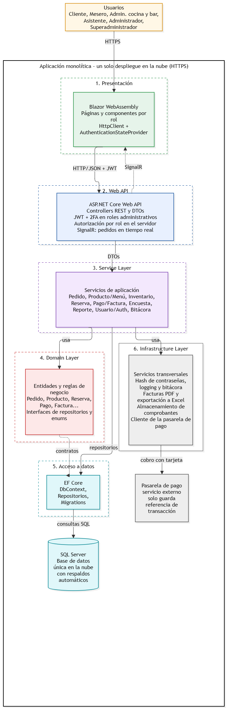
</p>

### Flujo Animado por Capas y SignalR

<p align="center">
  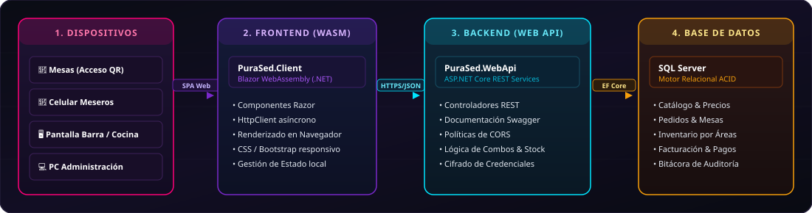
</p>

### Capas y responsabilidades

| Capa | Responsabilidad |
| :--- | :--- |
| **Presentación** | Blazor WebAssembly, páginas y componentes responsivos por rol. Consume la API mediante `HttpClient` y mantiene el estado de autenticación. |
| **Web API** | Controladores REST, DTOs, validación de entradas, autenticación JWT, autorización por rol y hub de SignalR. No contiene reglas de negocio. |
| **Service Layer** | Orquesta los casos de uso de pedidos, menú, inventario, reservas, pagos, facturación, encuestas, reportes, usuarios y bitácora. |
| **Domain Layer** | Define entidades, enumeraciones, reglas de negocio e interfaces de repositorio sin depender de infraestructura. |
| **Acceso a datos** | Entity Framework Core, `DbContext`, repositorios y migraciones para persistir la información en SQL Server. |
| **Infrastructure Layer** | Servicios transversales: hashing de contraseñas, logging, bitácora, generación de facturas PDF, exportación a Excel, almacenamiento de comprobantes e integración con pagos. |

### Comunicación, seguridad y tiempo real

- El cliente no accede directamente a SQL Server; todos los datos pasan por la Web API.
- Las comunicaciones utilizan HTTPS y JSON mediante DTOs.
- El personal se autentica con JWT; los roles administrativos incorporan verificación en dos pasos y autorización en el servidor.
- SignalR notifica a cliente, cocina y bar los cambios de estado de una comanda sin recargar la página.
- La pasarela de pago solo se integra para procesar el cobro y conservar la referencia de la transacción; no se almacenan datos sensibles de tarjetas.
- SQL Server concentra la base de datos del sistema y debe operar con respaldos automáticos.

La especificación completa se encuentra en [`Entregables/SP2/Arquitectura del sistema/Diseño arquitectura sistema.md`](./Entregables/SP2/Arquitectura%20del%20sistema/Dise%C3%B1o%20arquitectura%20sistema.md).

---

##  Casos de Uso

Representación formal interactiva de los actores del negocio (*Cliente*, *Mesero*, *Cocina/Bar*, *Asistente* y *Administrador*) y sus flujos de interacción con el sistema dentro del límite de la plataforma:

<p align="center">
  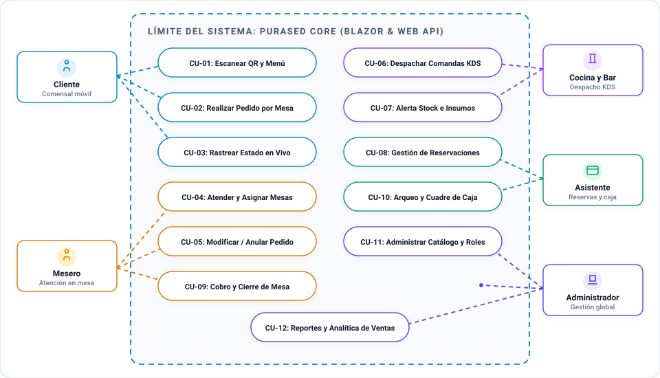
</p>

---

##  Modelo de Base de Datos – Diagrama Entidad-Relación

El sistema Pura Sed cuenta con un modelo de base de datos relacional diseñado en SQL Server, conformado por **23 entidades** que permiten administrar los usuarios, productos, pedidos, reservas, inventario, pagos, facturación y espectáculos.

El diagrama entidad-relación representa las entidades del sistema, sus atributos, claves primarias (PK), claves foráneas (FK) y las relaciones existentes entre ellas. Para representar las cardinalidades se utiliza la notación de pata de gallo (*Crow's Foot*), que permite identificar las relaciones obligatorias y opcionales.

<p align="center">
  
</p>

El modelo permite relacionar los pedidos con las sesiones de mesa, controlar automáticamente los movimientos de inventario y gestionar las cuentas de los clientes. También contempla el cobro opcional de entradas por persona cuando existen espectáculos.

---

##  Prototipo Interactivo y Diseño en Figma

El sistema visual de **PuraSed** encarna la estética de **Taller Indie Craft & Herencia Andina** (*Sereno Moreno*, Centro Histórico de Quito), alejándose de plantillas genéricas. En Figma se diseñaron **32 pantallas Full HD (1920×1080)** con flujos navegables completos divididos en 3 módulos coordinados:

<p align="center">
  <a href="https://www.figma.com/design/DsNPoA8toR0BhSr1jCQvq1/Pura-Sed?node-id=0-1&t=fsQYngq4znHIIZzZ-1" target="_blank" rel="noopener noreferrer">
    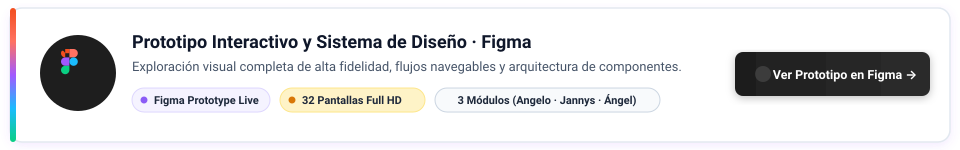
  </a>
</p>

<p align="center">
  
</p>

### Distribución Funcional por Subsistema

| Módulo en Figma | Responsable | Enfoque y Flujos Principales |
| :--- | :--- | :--- |
| **1. Front-Office: Menú Orbital POS 3D** | **Angelo Conterón** (*Frontend Lead*) | Bienvenida en mesa sin fricción, Menú Orbital 3D en 5 capítulos culturales, vista detalle en Three.js (-45°) con ticket tiza inclinado (1.2°), drawer comanda, timeline en vivo, pago, factura y encuesta. |
| **2. Back-Office: KDS / KDD y Salón** | **Jannys Garrido** (*Scrum Master*) | Login RBAC, pantalla táctil KDD Barra de Fermentos, pantalla KDS Cocina de Paila por orden cronológico, formulario de reservas públicas y mapa interactivo de mesas. |
| **3. Back-Office: Caja, Stock y Analítica** | **Ángel Chicaiza** (*Backend Architect*) | Punto de caja y arqueo diario, validación de transferencias, inventario y conmutación de platos agotados (HU-10), promociones, matriz de 8 roles, bitácora y reportes. |

<details>
<summary><b>Ver desglose completo de pantallas y tokens visuales por módulo</b></summary>

* **Paleta e Identidad (*Taller Indie Craft*):** Fondo basalto (`#121614` / `#1F2421`), Oro Inti (`#E59F38`), Blanco Tiza (`#FFFDF9`) y Terracota Paila (`#B85335`).
* **Front-Office (Comensal):** Selección de mesa sin registro previo, carrusel orbital y detalle 3D (`Mockups_Figma`), seguimiento reactivo de comanda (`Pendiente` → `En preparación` → `Listo` → `Entregado`) y encuesta post-consumo.
* **Back-Office Operativo (Salón, Cocina y Barra):** Autenticación del personal, aislamiento KDS/KDD por área y prevención de solapamiento de reservas en mapa interactivo de mesas.
* **Back-Office Gerencial (Administración):** Liquidación en ticket tiza, administración del menú por franjas y control de auditoría del personal.

</details>

---

##  Seguridad, Identity JWT y Matriz de Roles

El control de acceso se implementa con **ASP.NET Core Identity**, emisión de tokens **JWT Bearer (HMAC-SHA256)** mediante `TokenService` y políticas centralizadas bajo principios **SOLID** y **DRY** en `PuraSed.WebApi/Constants/Roles.cs` (`8` roles independientes agrupados en constantes para `[Authorize(Roles = ...)]`).

<p align="center">
  
</p>

### Endpoints de Autenticación y Credenciales Sembradas (`IdentitySeeder`)

En entorno de desarrollo (`Development`), `Program.cs` ejecuta automáticamente las migraciones de EF Core y siembra la base de datos mediante `IdentitySeeder`, `ProductoSeeder` y `MesaSeeder`. Las solicitudes autenticadas obtienen su token en `POST /api/Auth/login` (o registro público en `POST /api/Auth/register`):

| Usuario | Correo Electrónico | Contraseña Seed | Rol(es) Asignado(s) | Alcance Operativo |
| :--- | :--- | :--- | :--- | :--- |
| `admin` | `admin@purased.com` | `Admin123` | `Admin`, `SuperAdmin` | Control total, bitácora, menú, promociones, reportes |
| `mesero` | `mesero@purased.com` | `Mesero123` | `Mesero` | Toma de pedidos en mesas (`HU-13`), estado de salón |
| `cocina` | `cocina@purased.com` | `Cocina123` | `AdminCocina` | Panel KDS de cocina e inventario de platos (`HU-11`, `HU-15`) |
| `bar` | `bar@purased.com` | `Bar12345` | `AdminBar` | Panel KDD de barra, fermentos y bebidas (`HU-11`, `HU-15`) |
| `asistente` | `asistente@purased.com` | `Asistente123` | `Asistente` | Gestión de reservas y disponibilidad de mesas (`HU-18`) |
| `cliente` | `cliente@purased.com` | `Cliente123` | `Cliente`, `Usuario` | Auto-orden desde tablet en mesa (`HU-01`, `HU-13`) |

---

##  Estructura de la Solución .NET

El repositorio utiliza el formato unificado moderno de .NET (`.slnx`), manteniendo separadas las responsabilidades de UI WebAssembly, Web API REST, lógica de negocio (`Services/`) y acceso a datos (`Repositories/`):

<p align="center">
  
</p>

<details>
<summary><b>Ver árbol detallado de carpetas y archivos del repositorio</b></summary>

```text
pura-sed/
├── PuraSed.slnx                        # Solución moderna .NET 10 (WebApi + Client)
├── README.md                           # Documentación técnica y visual del sistema
├── .gitignore                          # Exclusión de artefactos binarios (bin/, obj/)
├── assets/                             # SVGs animados adaptativos (Dark/Light) e íconos
│   ├── banner.svg, tags.svg            # Hero con burbujas y lienzo tecnológico oficial
│   ├── figma-board.svg, figma-modules.svg  # Portal oficial y 3 módulos Figma
│   ├── architecture.svg, casos-de-uso.svg  # Diagramas animados de arquitectura y UML
│   ├── security-rbac.svg, git-flow.svg # Matriz JWT/RBAC y flujo GitFlow animado
│   ├── jira-board.svg, structure.svg   # Portal Scrum en Jira Cloud y explorador .NET
│   ├── PuraSed_Diagrama_ER.svg         # Diagrama Entidad-Relación (23 entidades)
│   └── team/, icons/                   # Tarjetas orbitales del equipo e iconografía SVG
├── Entregables/                        # Artefactos académicos y documentación EPN
│   ├── SP1/, SP2/, Sprint2/            # Alcance, HU, UML, ER y Acoplamiento_Roles.md
│   └── Mockups_Figma/                  # Prototipos HTML5/Three.js, capturas y manuales
├── retrospective/                      # Actas de retrospectiva Scrum por sprint
│   ├── README.md                       # Índice de retrospectivas
│   ├── SP1_REVIEW.md                   # Cierre y aprendizajes Sprint 1
│   ├── SP2_RREVIEW.md                  # Cierre y aprendizajes Sprint 2
│   └── SP3_REVIEW.md                   # Cierre y aprendizajes Sprint 3
├── PuraSed.WebApi/                     # Backend ASP.NET Core Web API (.NET 10)
│   ├── Constants/                      # Roles.cs (8 roles DRY y constantes [Authorize])
│   ├── Controllers/                    # Auth, Mesas, Pagos, Pedidos, Productos, Reportes, Usuarios
│   ├── Data/                           # PuraSedDbContext, IdentitySeeder, ProductoSeeder, MesaSeeder
│   ├── DTOs/, Models/, Migrations/     # Contratos tipados, entidades y migraciones EF Core
│   ├── Repositories/, Services/        # Patrón Repository y servicios SOLID desacoplados
│   ├── Properties/launchSettings.json  # Perfiles HTTPS 7129 / HTTP 5107
│   ├── appsettings.json                # Configuración SQL Server, Jwt:Issuer/Audience/Key
│   └── Program.cs                      # DI, Identity + JWT Bearer, CORS, Seeders y Swagger
└── PuraSed.Client/                     # Frontend Blazor WebAssembly (.NET 10 SPA)
    ├── Layout/, Pages/                 # Navegación maestra y vistas Razor por rol
    ├── Properties/launchSettings.json  # Perfiles HTTPS 7020 / HTTP 5068
    ├── wwwroot/                        # Assets estáticos, CSS globales y runtime WASM
    └── Program.cs                      # Configuración WebAssembly, HttpClient y servicios
```

</details>

---

##  Guía de Ejecución Local

### Prerrequisitos del Entorno

* [.NET 10.0 SDK](https://dotnet.microsoft.com/download/dotnet/10.0) instalado localmente.
* [Microsoft SQL Server 2022](https://www.microsoft.com/sql-server/) o instancia local de LocalDB.
* [Git](https://git-scm.com/) configurado en el sistema operativo.

### Pasos de Puesta en Marcha

1. **Clonar el repositorio y situarse en la rama de integración:**
   ```bash
   git clone https://github.com/angelch1595-glitch/pura-sed.git
   cd pura-sed
   git checkout develop
   ```

2. **Restaurar paquetes y compilar la solución:**
   ```bash
   dotnet build PuraSed.slnx
   ```

3. **Ejecutar el Backend (ASP.NET Core Web API):**
   ```bash
   dotnet run --project PuraSed.WebApi --launch-profile https
   ```
   > Al arrancar en entorno `Development`, el backend aplica automáticamente las migraciones de EF Core y ejecuta `IdentitySeeder`, `ProductoSeeder` y `MesaSeeder`. La raíz `/` redirige directamente a la interfaz interactiva de **Swagger** con botón `Authorize (Bearer JWT)`.
   * *Swagger UI interactiva:* `https://localhost:7129/swagger`
   * *Puerto HTTPS:* `7129` | *Puerto HTTP:* `5107`

4. **Ejecutar el Frontend (Blazor WebAssembly):**
   En una terminal adicional, iniciar el cliente web:
   ```bash
   dotnet run --project PuraSed.Client --launch-profile https
   ```
   * *Aplicación Web:* `https://localhost:7020`
   * *Puerto HTTPS:* `7020` | *Puerto HTTP:* `5068`

---

## 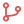 Estrategia de Ramas y Flujo en Git

El proyecto sigue una adaptación rigurosa de **GitFlow** sobre ramas de integración continua y entregables incrementales por sprint:

<p align="center">
  
</p>

### Políticas de Integración

* **Rama `main`**: Contiene únicamente código estable, probado y listo para despliegue en producción.
* **Rama `develop`**: Rama base de integración diaria donde convergen las características finalizadas.
* **Ramas de funcionalidad (`feature/<id>-<descripcion>`)**: Ramas temporales creadas a partir de `develop` para el desarrollo de cada historia de usuario.
* **Convención de Commits Semánticos**:
  * `feat:` Nueva funcionalidad o capacidad implementada.
  * `fix:` Corrección de errores o defectos detectados.
  * `docs:` Actualización de documentación técnica o README.
  * `style:` Ajustes de formato, maquetación o diseño visual.
  * `refactor:` Reorganización de código sin alterar su comportamiento externo.

---

##  Backlog, Planificación y Sprints

El ciclo de desarrollo está organizado bajo el marco de trabajo **Scrum**, con planificación iterativa e historias de usuario gestionadas en el tablero oficial de Atlassian Jira Software:

<p align="center">
  <a href="https://jannysgarrido21.atlassian.net/jira/software/projects/SCRUM/boards/1">
    
  </a>
</p>

### Metodología de Trabajo y Gestión Ágil

* **Historias de Usuario (HU)**: Cada funcionalidad del sistema se modela bajo el formato formal:
  $$\text{Como } [\text{Rol de negocio}] \quad \text{quiero } [\text{Acción / Capacidad}] \quad \text{para } [\text{Beneficio esperado}]$$
* **Criterios de Aceptación (Definition of Done)**: Cada requerimiento cuenta con condiciones de validación verificables antes de ser promovido al siguiente estado.
* **Estimación por Story Points**: Planificación de esfuerzo basada en la serie de Fibonacci para medir la velocidad del equipo.
* **Flujo de Estados en el Tablero Jira**:
  $$\text{Backlog} \;\longrightarrow\; \text{Por Hacer (To Do)} \;\longrightarrow\; \text{En Progreso} \;\longrightarrow\; \text{Revisión/ QA} \;\longrightarrow\; \text{Listo (Done)}$$

---

##  Licencia y Uso Académico

Este proyecto ha sido desarrollado con fines estrictamente académicos para la asignatura **ITID803 · Diseño de Aplicaciones y Servicios para Internet (DASI)** en la **Escuela Politécnica Nacional (EPN)**, Facultad de Ingeniería Eléctrica y Electrónica (FIEE), correspondiente al periodo lectivo **2026**.

Todos los derechos reservados al equipo de desarrollo y a la institución académica correspondiente.
